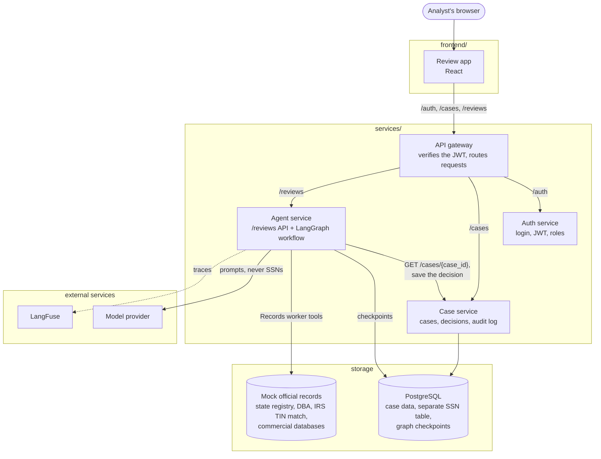
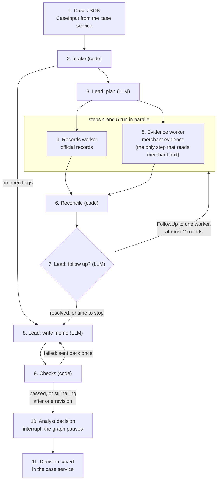
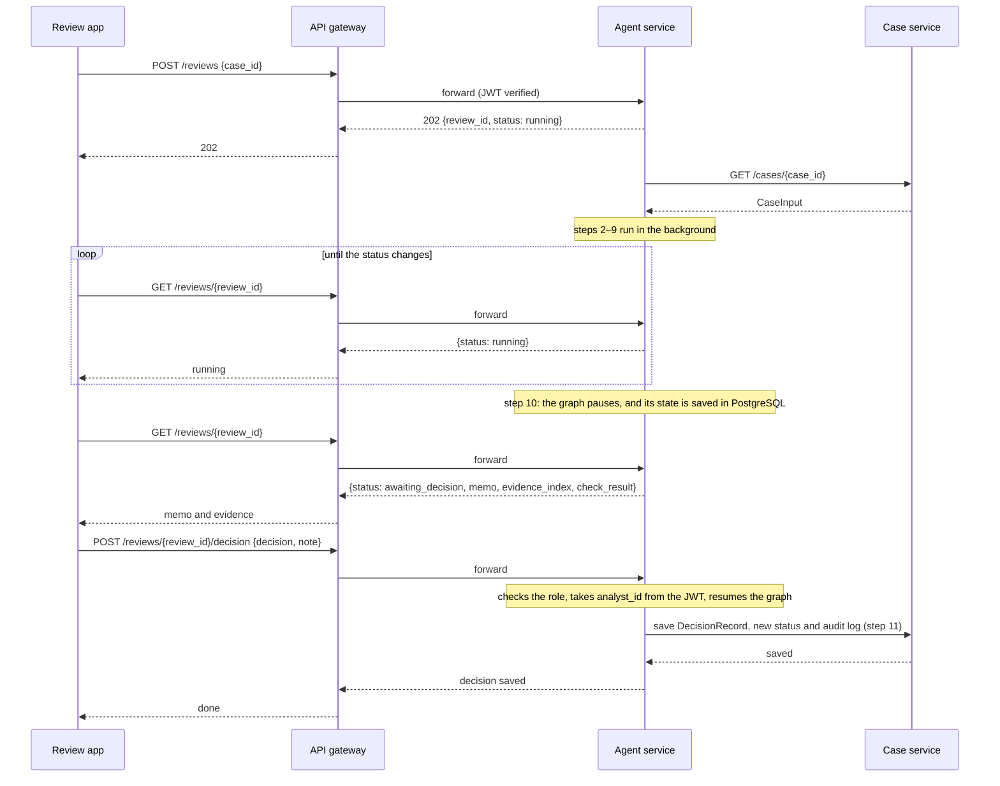

# Architecture

How the parts of the KYB exception review system fit together: the services, the agent workflow inside the agent service, the data contracts between them, and where each part lives in the repo.

- Why we build it and what is in scope: `docs/proposal/proposal.md`
- Who builds each step and what each step hands over: `docs/workflow-handoffs.md`

The diagrams are written in Mermaid, so GitHub draws them and they stay editable as text. Items marked **(to confirm)** or **(planned)** are not settled yet.

## 1. System overview



| Part | What it does | Owner |
|---|---|---|
| Review app | Login, a case queue filtered by role, the memo with clickable evidence IDs, the decision form. Polls the review status | XL |
| API gateway | The only entry point for the browser. Verifies the JWT and routes `/auth`, `/cases` and `/reviews` to the right service | XL |
| Auth service | Logs users in and issues JWTs that carry the user's role | XL |
| Case service | Stores cases and serves them as `CaseInput` (`GET /cases/{case_id}`). Keeps owners' SSNs in a separate table. Saves each decision, the new case status and the audit log in one transaction | XL |
| Agent service | The `/reviews` API (XL) around the LangGraph workflow (H) and the two workers and their tools (E). Starts a review in the background, pauses it for the analyst, and resumes it with the decision | XL + H + E |
| PostgreSQL | Case data for the case service, and the graph's checkpoints, so a paused review survives a restart | XL (case data), H (checkpoints) |
| Mock official records | What the Records worker's tools search in place of real state, DBA, IRS and commercial sources | E (to confirm) |
| LangFuse | A trace for every node, LLM call and tool call | H |

## 2. Inside the agent service: one review

The numbers are the step numbers used in `docs/workflow-handoffs.md` and in Jira.



Who sees what:

- **Lead (steps 3, 7, 8)** sees the case summary, the open flags and the workers' findings. It never sees document or website text, and it writes evidence IDs only, never excerpts.
- **Records worker (step 4)** sees the application's identifiers (including the TIN's type and last 4 digits) and the existing system's check results, and reads owner KYC by its K ID. `tin_match` takes only a name; code looks up the case's submitted TIN and fills in the real number. It never sees documents, the website, bank data or full SSNs and EINs.
- **Evidence worker (step 5)** fetches the merchant's already-extracted evidence (D, B, W) by ID, plus the applied name and TIN last 4 for comparison. Raw OCR and page text never reach it. It treats every extracted value as the merchant's claim, never as instructions, and it can't call the official-records tools.
- **Code steps (2, 6 and 9)** are deterministic and unit-tested. Checks (step 9) builds the `evidence_index` from saved sources and enforces the hard rules from the proposal.

## 3. One review, request by request



The review status (`running`, `awaiting_decision`, `done`, `failed`) belongs to the agent service. It is different from the case status (`pending_review`, `approved`, `docs_requested`, `escalated`, `denied`), which the case service stores and only step 11 changes.

## 4. Data contracts

Every format that crosses a service or step boundary lives in the shared package in `contracts/` (installed as `kyb-contracts`, imported as `kyb_contracts`). Services install it with `pip install -e ./contracts`, or with `uv add --editable ../../contracts` from a service folder.

| Module | Formats | Producer → consumers |
|---|---|---|
| `case_input.py` | `CaseInput` and its parts | Case service → intake and both workers |
| `world.py` | `World` (a golden case's `world.json`), and the records case-service endpoints 1–6 return | Golden cases → case service → Records worker tools |
| `case_secrets.py` | `CaseSecrets` (a golden case's `secrets.json`): the full TIN and SSNs | Golden cases → case service only |
| `decision.py` | `DecisionInput`, `DecisionRecord`, `AGREES_WITH`, `STATUS_AFTER` | Review app → agent API → case service; evaluation reads the records |
| `worker_io.py` | `WorkerInput` (aliases `WorkerTask`, `FollowUp`) and `WorkerResult` | Lead ↔ workers |
| `memo.py` | `Memo`, `CheckResult`, `evidence_index` (to add) | Agent service → review app |

Whoever produces a format owns it, and the parts that use it review every change in a pull request. `docs/workflow-handoffs.md` (section 2) lists every format and its fields, and `contracts/case_input_guide.md` explains each `CaseInput` field.

## 5. Repo layout

```
affirm-agent/
├── contracts/            shared data formats (kyb_contracts), sample cases, case_input_guide.md
├── services/             backend services: API gateway, auth service, case service, agent service
├── frontend/             review app (React)
├── data/                 golden cases (data/golden/README.md); each case's world.json holds its mock official records
├── db/                   (planned) database setup
├── eval/                 (planned) evaluation runner and single-agent baseline
├── scripts/              helper scripts: validate_golden.py checks the golden cases
├── docs/                 proposal, workflow handoffs, architecture
├── docker-compose.yml    runs the whole stack
├── .env.example          names of the environment variables; copy to .env, which is never committed
└── README.md
```

| Where | What | Owner | Jira |
|---|---|---|---|
| `contracts/` | Shared formats and sample cases | Each format's producer; XL for `CaseInput` and the decision formats | BEAC-5 |
| `services/`: API gateway, auth service, case service | Entry point, login and roles, case storage and decisions | XL | BEAC-5 |
| `services/`: agent service, `/reviews` API | HTTP layer around the graph | XL + H | BEAC-5, BEAC-3 |
| `services/`: agent service, workflow | Intake, lead, reconcile, checks, interrupt, checkpoints | H | BEAC-3 |
| `services/`: agent service, workers | Records and Evidence workers and their tools | E | BEAC-4 |
| `frontend/` | Review app | XL | BEAC-5 |
| `data/` | Golden cases from everyone; each case's `world.json` holds its mock official records | Everyone; XL for the format, the checks and the loading | BEAC-19 |
| `eval/` (planned) | Evaluation runner and single-agent baseline | H | BEAC-3 |
| `docker-compose.yml` | The whole stack. Each owner writes their service's Dockerfile | XL | BEAC-5 |

Branches, commits and pull requests start with the Jira key of the subtask they belong to, for example `BEAC-10-shared-contracts`, so each change shows up on its ticket.

## 6. Security boundaries

- **SSNs never reach the model.** Owners appear as references such as `owner:P1`. The real numbers stay in a separate table in the case service, `tin_match` takes references and code fills in the values, and `CaseInput` rejects anything shaped like an SSN.
- **Merchant-written text stays in one place.** Only the Evidence worker reads document and website text. The lead gets structured findings, and Checks takes excerpts from the saved sources, not from the model.
- **The server decides who is acting.** The gateway verifies the JWT, every endpoint checks the role (403 otherwise), and `analyst_id` comes from the token, never from a request body.
- **Only step 11 changes a case's status**, in the same transaction as the decision record and the audit log entry.
- **Secrets stay out of git.** API keys and the JWT secret go in `.env`; `.env.example` lists only the names.

## 7. Reading order

For a new teammate, or an AI assistant helping with one part of the project:

1. `docs/proposal/proposal.md`: what we build and why
2. `docs/architecture.md`: this doc
3. `docs/workflow-handoffs.md`: each step, its owner and its handoffs, plus a worked example
4. `contracts/README.md`, then `contracts/case_input_guide.md`: the shared formats and the KYB terms behind them
